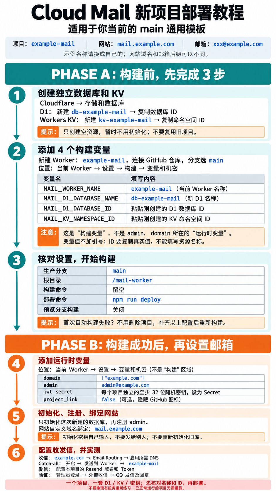

# Cloud Mail 新项目图文部署教程

适用于本仓库当前通用模板：实际部署分支选择 `main` 或 `qq-sender-template`。
文档分支仅用于查看教程，不要把它选为 Cloudflare 生产或预览部署分支。

> 本教程只用于全新项目。已正常运行的服务不需要重做，更不要重新初始化旧数据库。
>
> 与原项目不同，这个模板新增了 4 个构建变量，避免误部署到旧 Worker、误用旧数据库。这是部署隔离配置，不是 QQ 去“代发”本身必须的设置。

## 一张图看完整顺序



[打开原尺寸流程图](doc/images/deploy-guide.png)

**先建独立 D1 / KV → 填 4 个构建变量 → 构建部署 → 填运行时变量 → 初始化和注册 → 配置收发信。**

下面的名称全部是示例，请替换成你自己的，不要照抄 ID 或复用旧项目资源。

| 项目内容 | 本教程示例 |
| --- | --- |
| Worker 项目名称 | `example-mail` |
| 网站访问地址 | `https://mail.example.com` |
| 邮箱后缀 | `@example.com` |
| 管理员完整邮箱 | `admin@example.com` |
| 新 D1 数据库名称 | `db-example-mail` |
| 新 KV 命名空间名称 | `kv-example-mail` |

网站地址和邮箱后缀可以不同。本例登录网站是 `mail.example.com`，收信地址是 `admin@example.com`，不是 `admin@mail.example.com`。

## 构建前：先完成第 1 至 3 步

### 1. 创建独立 D1 数据库和 KV

在 Cloudflare 控制台进入“存储和数据库”：

1. 打开 **D1 → 创建数据库**，名称填写 `db-example-mail`。
2. 创建后复制这个新数据库的 **数据库 ID**，通常是带连字符的 UUID。
3. 打开 **Workers KV → 创建命名空间**，名称填写 `kv-example-mail`。
4. 创建后复制这个新命名空间的 **ID**，通常是 32 位十六进制字符。

现在只创建空资源，**不用提前建表、导入数据或初始化**。D1 和 KV 的名称、ID 是两回事，后面要分别填写。

### 2. 创建 Worker 并填写 4 个构建变量

进入 **Workers 和 Pages → 创建应用程序**，连接本 GitHub 仓库，项目名设为 `example-mail`，生产分支选择 `main`。
界面按钮名称可能调整，但应选择 Git 仓库关联的 Worker 构建流程，不是 Pages 项目。

在创建向导中填写构建变量；如果向导没有这个入口，先创建项目，再进入：

**当前 Worker → 设置 → 构建 → 变量和机密**。

| 变量名：原样填写，注意大小写 | 变量值：换成你本次新建的资源 |
| --- | --- |
| `MAIL_WORKER_NAME` | `example-mail`，必须与当前 Worker 名称一致，不是网站域名 |
| `MAIL_D1_DATABASE_NAME` | `db-example-mail`，必须与新 D1 的名称一致 |
| `MAIL_D1_DATABASE_ID` | 粘贴第 1 步复制的 **新 D1 数据库 ID**，不是名称 |
| `MAIL_KV_NAMESPACE_ID` | 粘贴第 1 步复制的 **新 KV 命名空间 ID**，不是名称 |

填写注意事项：

- 这 4 个变量是本模板新增的，不会由 Cloudflare 自动填好。
- 填在“构建”的变量区域，不能只填在 `admin`、`domain` 所在的运行时变量区域。
- 变量值不加引号、不带前后空格，不填写 `https://` 或 `@`。
- Worker 名称用小写字母、数字和连字符；D1 名称用字母、数字、下划线和连字符。
- 本模板不会自动创建资源。必须填写已经创建成功的资源 ID。
- 不要使用任何旧邮箱项目的 D1 或 KV ID。格式正确不代表资源归属正确，部署前仍要核对。

### 3. 核对构建设置并部署

| 设置项 | 填写内容 |
| --- | --- |
| 生产分支 | `main`，或 `qq-sender-template` |
| 根目录 | `/mail-worker` |
| 构建命令 | 留空 |
| 部署命令 | `npm run deploy` |
| 非生产分支 / 预览分支构建 | **关闭** |

预览构建开关在“构建”的预览相关设置中，保存后确认确实关闭。不要使用默认的 `npx wrangler deploy`，也不要手动填写旧项目的 Wrangler 资源 ID。

如果创建项目时 Cloudflare 已经自动开始首次构建，并提示：

```text
Missing or invalid MAIL_WORKER_NAME. See DEPLOY-TEMPLATE.md.
```

说明模板没有读到正确的构建变量。**不用删除项目，也不用修改业务代码**：补齐并保存 4 个变量及构建设置，然后对 `main` 重新构建。缺少其他变量时也会提示对应名称。

构建成功后，在 Worker 的 **绑定** 中确认：

- `db` 指向本次新建的 `db-example-mail`。
- `kv` 指向本次新建的 `kv-example-mail`。

如果显示其他项目的资源，先纠正构建变量并重新部署，不要继续初始化或注册。

## 构建后：再完成第 4 至 6 步

### 4. 添加运行时变量

进入 **当前 Worker → 设置 → 变量和机密**。注意不是前面“构建”里的同名区域。

| 名称 | 本教程示例 / 填写要求 |
| --- | --- |
| `domain` | 文本值 `["example.com"]`，是邮箱后缀，不带 `@`，保留 JSON 数组的括号和双引号 |
| `admin` | 文本值 `admin@example.com`，是完整管理员邮箱 |
| `jwt_secret` | 本项目独立的至少 32 字符随机字母数字密钥，类型选择 **Secret / 密钥** |
| `project_link` | 可选，文本值 `false`，隐藏登录页右下角 GitHub 图标 |

保存并部署变量。不要复用其他项目的密钥，也不要把密钥发到聊天、截图或提交到 GitHub。

**先确定最终邮箱后缀再注册。以后修改 `admin` 或 `domain` 变量，不会自动迁移数据库里已经注册的账号，可能导致原账号登录失败。**

### 5. 初始化新库、注册管理员并绑定网站

1. 在 Worker 中添加网站自定义域名 `mail.example.com`。它是网站地址，不等于邮箱后缀。
2. 只对确认无误的全新数据库执行初始化。在浏览器地址栏自行输入 `https://mail.example.com/api/init/`，后接你设置的 `jwt_secret`，按原项目流程确认返回 `success`。
3. 初始化地址包含密钥，不要分享完整链接、拍照或发给别人；完成后关闭该页面。不确定目标数据库是否全新时，先停止核对，不要再次初始化旧库。
4. 打开网站，注册 `admin`，完整地址应为 `admin@example.com`，密码自行设置并保管。
5. 登录并确认管理员菜单正常，没有出现其他项目的账号或邮件。

初始化入口以实际部署的项目实现为准。不要用公开示例密钥，也不要在 GitHub 中记录真实初始化地址。

### 6. 配置收发信，做一次真实验证

**收信使用 Cloudflare Email Routing：**

1. 在邮箱后缀所在的区域启用 Email Routing，本例是 `example.com`，不是网站子域名 `mail.example.com`。
2. 由 Cloudflare 自动添加所需的 MX、SPF 和 DKIM。操作前检查现有邮件服务及 SPF，避免覆盖其他业务。保留现有网站 A / AAAA 等记录。
3. MX 应对应实际邮箱后缀；本例在 `example.com` 区域的根域名 `@`，不要误填成 `mail`。
4. Catch-all / 全收选择 **发送到 Worker → example-mail**，保存后还要确认开关已开启、状态为 **活跃**。
5. 如果已有单独的收件规则，检查是否优先匹配到了其他目标。Catch-all 仅处理没有被单独规则匹配的来信。

**发信使用 Resend：**

在 Resend 验证本项目的发信域名，然后在 Cloud Mail 后台填写本项目相应的 Resend 配置。不要复制或修改旧项目的 Token。本模板不自动配置 Resend，也不自动启用收信路由。

**上线前逐项验证：**

- [ ] 管理员能正常登录，邮箱后缀正确。
- [ ] `db` 和 `kv` 绑定均为本项目独立资源。
- [ ] 公网 DNS 能查到正确的收信 MX，Catch-all 活跃且目标为本 Worker。
- [ ] 从外部邮箱发送一封新邮件到管理员地址，确认实际出现在收件箱。
- [ ] 检查 Email Routing 活动记录和 Worker 的 `email` 事件，不能把网站 HTTP 请求成功当成收信成功。
- [ ] 从正式网站发一封邮件到自己的 QQ 邮箱，确认投递和显示效果，再测试一次回复。

QQ Sender 修复已包含在本模板中，但收件平台的显示规则不受本项目控制，新域名仍需实测。其他邮箱不保证隐藏“代发”。发件方提示“发送成功”也不等于已经进入本项目收件箱；新 DNS 记录还可能需要等待缓存更新。

## 常见问题速查

| 现象 | 优先检查 |
| --- | --- |
| 缺少 `MAIL_...`，构建失败 | 是否填了全部 4 个变量，是否误填到运行时区域，名称和 ID 是否正确 |
| 已填变量但仍提示缺少 | 确认保存到了当前项目的生产构建环境，再重新构建；不要只保存到预览环境 |
| 用默认部署命令失败 | 改为 `npm run deploy`，根目录为 `/mail-worker` |
| 提示生产分支限制 | 实际部署选择 `main` 或 `qq-sender-template`，不是文档或预览分支 |
| 网站能开，但无法登录 | 运行时变量、初始化、管理员注册是否完成；数据库绑定是否正确 |
| 修改后缀后原账号不存在 | 修改变量不会迁移已有账号；先核对原库和原账号，不要清库、重置密钥或重复注册来碰运气 |
| 网站正常，但收不到邮件 | MX、Email Routing、Catch-all 开关、单独规则和目标 Worker |
| 数据库绑定改完，下次构建又变回去 | 同时维护构建变量，下一次构建会根据变量重新生成绑定 |

## 后续维护

- 多个项目可以共用 `main`，但每个项目必须使用各自的 D1、KV、构建变量和密钥。
- 分支共用不等于发布隔离：推送到各项目跟踪的生产分支，可能触发所有启用自动构建的关联项目。
- 只更新教程也可能触发构建，不能假设 Markdown 或图片会自动被忽略。合并文档到生产分支前，先核对自动构建和构建监听路径。
- 如需独立发布，应单独规划生产分支和模板允许分支，不要随意切换已有服务。现有服务无需因为本教程而重新部署。

## 参考

- [模板技术说明、离线检查和旧项目迁移](DEPLOY-TEMPLATE.md)
- [Cloudflare 构建配置](https://developers.cloudflare.com/workers/ci-cd/builds/configuration/)
- [创建 D1 数据库](https://developers.cloudflare.com/d1/get-started/)
- [创建 KV 命名空间](https://developers.cloudflare.com/kv/get-started/)
- [Cloudflare Email Routing](https://developers.cloudflare.com/email-routing/)
